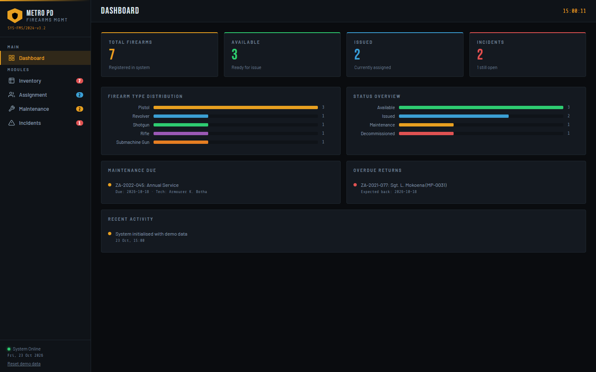
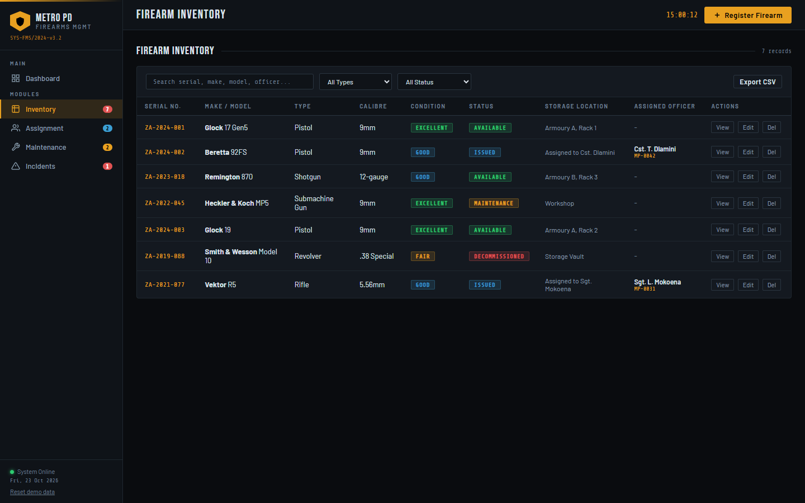
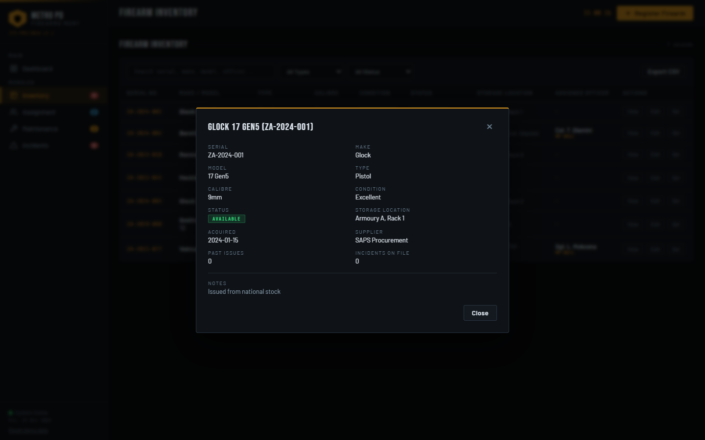
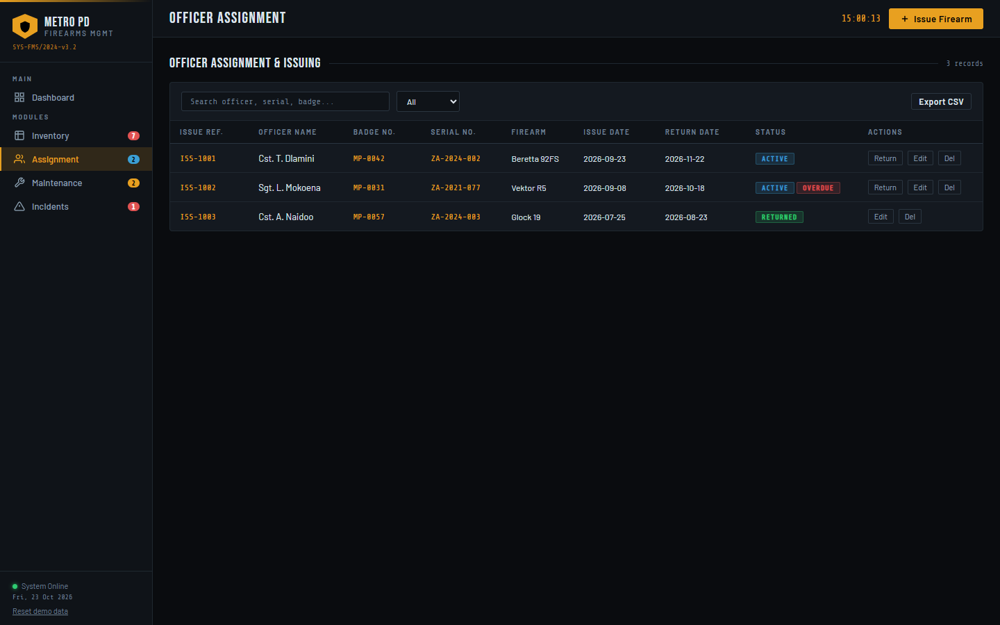
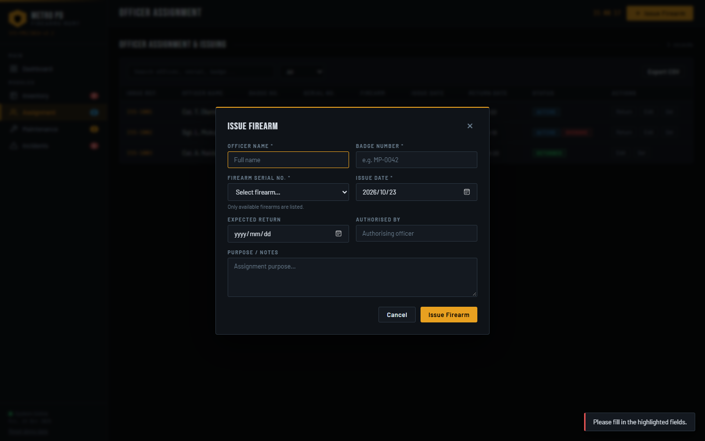
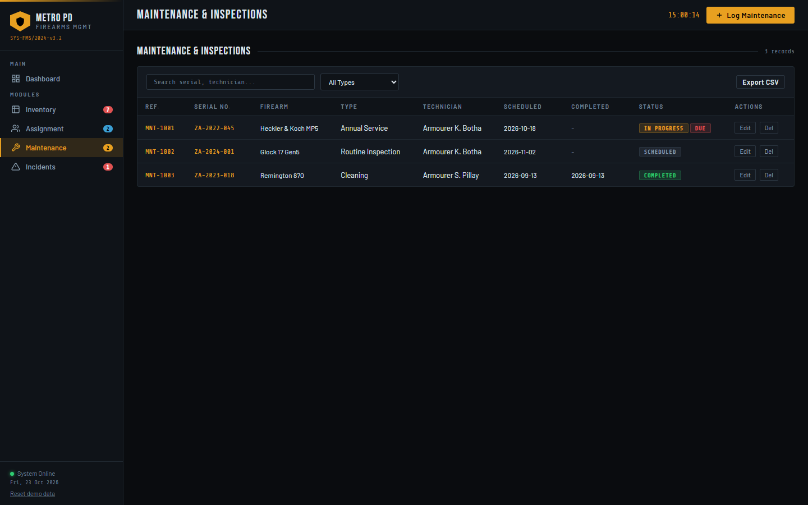
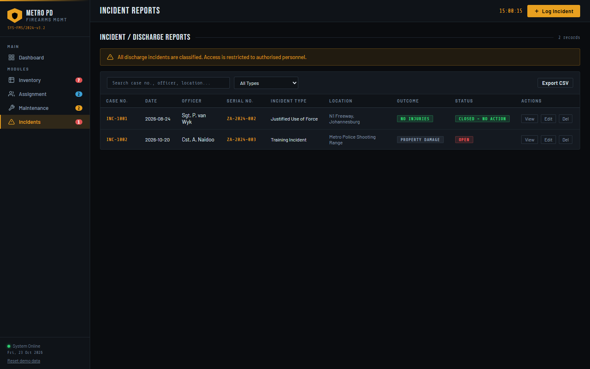
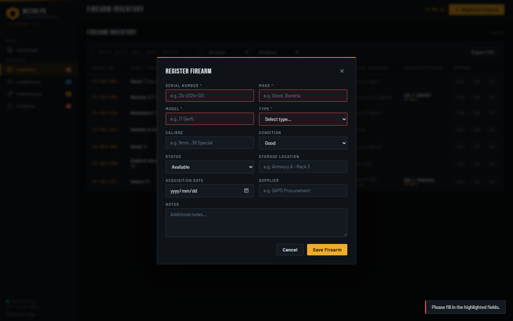
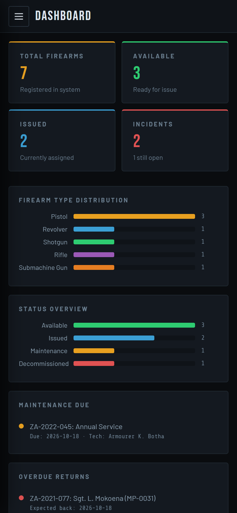
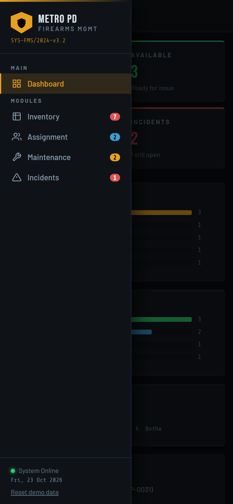

# Metro Police Firearms Management System

A browser based armoury management tool for a metro police department. It tracks the firearm inventory, who each firearm is issued to, maintenance and inspections, and discharge or loss incidents. It is plain HTML, CSS and JavaScript with no build step and no dependencies.

All data is stored in your browser (`localStorage`). Nothing is sent to a server.



## Getting started

1. Download or clone this folder.
2. Open `index.html` in any modern browser (Chrome, Edge, Firefox, Safari).

That is all. The app loads with demo data the first time you open it. Use **Reset demo data** at the bottom of the sidebar to restore it at any time.

The Google Fonts stylesheet needs an internet connection. Offline, the app falls back to system fonts and works the same.

## Project structure

```
Metro-Police-Firearms-System/
  index.html       Page markup, navigation and modal forms
  css/style.css    Styling and responsive layout
  js/app.js        Data store, rendering and all application logic
  screenshots/     Images used in this README
  README.md
```

## Features

### Dashboard
Live totals for registered, available and issued firearms and incident counts. The stat cards link to the matching list. Charts show the type and status mix. Panels list overdue maintenance, overdue returns and recent activity.

### Inventory
Register, view, edit and delete firearms. Search by serial, make, model, calibre, location or assigned officer, filter by type and status, and sort any column.





### Assignment
Issue a firearm to an officer, record the expected return date, and mark it returned. Active issues past their return date are flagged **Overdue**. Issuing a firearm marks it Issued and returning it makes it Available again.





### Maintenance
Log inspections, repairs, cleaning, upgrades and annual services. A firearm moves to Maintenance while a job is In Progress and back to Available when the job is Completed or Cancelled. Jobs that have reached their scheduled date are flagged **Due**.



### Incidents
File and track discharge, use of force, training and theft or loss reports with investigation status and outcome.



### Across the whole app
* Form validation with highlighted fields and clear messages
* Duplicate serial number and case number checks
* Rules that keep records consistent, such as blocking deletion of a firearm that is currently issued
* Confirmation dialogs for deletes and toast messages for every action
* Export the current table view to CSV
* Deep links and a working back button (`#inventory`, `#incidents`, and `#inventory/add` opens the register form)
* Keyboard friendly: Escape closes dialogs, labelled form fields, visible focus
* All user text is escaped before display
* Responsive layout with a slide out menu on phones



### Mobile

 

## Data model

Records live in `localStorage` under these keys: `fms_inventory`, `fms_assignments`, `fms_maintenance`, `fms_incidents`, `fms_log` and `fms_seeded`. Clear them in your browser dev tools, or use **Reset demo data**, to start over.

## Notes

This is a demonstration system with fictional records. It has no login or audit trail, so it is not suitable for managing real firearms records without a secure backend.
